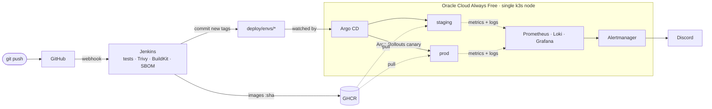

# SkyBook ✈️

**A flight-booking platform run like a production system: infrastructure as
code, a Jenkins pipeline with security gates, GitOps delivery with canary
releases, and full observability, on a budget of zero.**

| | Link | Access |
|---|---|---|
| App (production) | https://skybook-vinayak.duckdns.org | public |
| App (staging) | https://staging.skybook-vinayak.duckdns.org | public |
| Grafana dashboards | https://grafana.skybook-vinayak.duckdns.org | public, read-only |
| Argo CD | https://argocd.skybook-vinayak.duckdns.org | login |
| Jenkins | https://jenkins.skybook-vinayak.duckdns.org | login |


---

## What happens when I push a commit



1. **Every branch and pull request:** unit tests (pytest, node:test), lint
   (ruff), a dependency and secret scan (Trivy), container builds (BuildKit),
   an image scan, and a CycloneDX SBOM. A fixable CRITICAL vulnerability fails
   the build.
2. **`main` only:** images are pushed to GHCR tagged with the commit SHA.
   Jenkins commits the new tags to `deploy/envs/staging/values.yaml`, and
   Argo CD deploys them. Jenkins then waits until all three services report
   the new version.
3. **Production:** the `skybook-promote` job shows the tag diff, waits for
   approval, and copies staging's tags to prod. Argo Rollouts sends 50% of
   pods to the new version, checks the live 5xx ratio in Prometheus, then
   either completes the release or rolls it back automatically.

Jenkins never has cluster credentials; git is the only way anything changes
([ADR 0002](docs/adr/0002-gitops-delivery.md)).

## Architecture

| Layer | What runs | Why |
|---|---|---|
| App | `frontend` (nginx + vanilla JS), `flight-search` (Node.js/Express), `booking-api` (Python/FastAPI), Postgres | Polyglot microservices with a real database |
| Containers | Multi-stage, non-root, read-only root filesystem, pinned bases | Small, hardened images |
| Infrastructure | Terraform: VCN, security list, A1 VM, budget alert; remote state in OCI Object Storage | Reproducible, reviewable infrastructure |
| Configuration | Ansible: OS hardening, firewall, k3s, DuckDNS, cluster bootstrap with secrets from Ansible Vault | One command from blank VM to running cluster |
| Kubernetes | k3s, Traefik ingress, cert-manager + Let's Encrypt, CloudNativePG | TLS everywhere, operator-managed Postgres |
| CI | Jenkins (JCasC, Job DSL, multibranch, ephemeral Kubernetes pod agents), BuildKit, Trivy | Pipeline as code; controller rebuilt from config |
| CD | Argo CD (app-of-apps, sync waves, self-managed), Helm, Argo Rollouts | GitOps with automated canary analysis |
| Security | Trivy gates and SBOMs, Kyverno policies, NetworkPolicies (default deny), Pod Security settings, Ansible Vault | Defence in depth |
| Observability | kube-prometheus-stack, Loki + Grafana Alloy, Alertmanager → Discord, SLO burn-rate alerts, runbooks | You can see and act on what is happening |
| Reliability | Probes, HPA, PDBs, resource requests/limits, rolling updates and canaries | Releases and load spikes without downtime |

The whole platform (12 GB RAM, 2 vCPU) fits Oracle's Always Free tier.
[ADR 0001](docs/adr/0001-oracle-always-free-single-node-k3s.md) has the
memory budget and the trade-offs.

## Repository layout

```
services/            the three microservices, each with Dockerfile, tests and README
docker-compose.yml   the whole app locally
Jenkinsfile          CI pipeline for every branch and PR
ci/                  build pod specs, promotion pipeline, build/deploy scripts
infra/terraform/     Oracle Cloud network, VM, budget alert
infra/ansible/       hardening, k3s, DuckDNS, Argo CD bootstrap
deploy/charts/       Helm chart for SkyBook (Deployments or Rollouts, HPA, PDB,
                     NetworkPolicies, ServiceMonitor, alerts, Postgres cluster)
deploy/envs/         per-environment values; Jenkins edits only the image tags
deploy/argocd/       app-of-apps: every platform component as an Argo CD app
deploy/platform/     values for Argo CD, Jenkins, monitoring, policies
docs/                setup guide, architecture decisions, runbooks
```

## Highlights

- **Supply chain:** images are scanned before they are pushed and tagged
  with the commit SHA (never `:latest`), and each has an SBOM. The tools in
  the pipeline are pinned; Trivy was compromised upstream in March 2026
  (CVE-2026-33634).
- **Zero-trust networking:** each app namespace denies all ingress by default,
  and only the paths the app needs are opened, including the one for
  cert-manager's ACME solver so certificate renewals keep working.
- **SLOs, not just alerts:** a 99.5% availability SLO with multi-window,
  multi-burn-rate alerts. Every alert links to a runbook in `docs/runbooks`.
- **Policy rollout done safely:** Kyverno policies start in Audit mode, so
  violations show up in PolicyReports before anything is enforced.
- **Cost guardrails as code:** Terraform creates an OCI budget alert, and the
  design avoids the paid load balancer entirely.
- **Rebuildable from scratch:** `terraform apply` followed by
  `ansible-playbook site.yml` recreates everything; Argo CD restores the rest
  from git.

## Run it locally

```bash
docker compose up --build
# open http://localhost:8080
```

## Deploy your own

[docs/SETUP.md](docs/SETUP.md) covers everything from a fresh Windows laptop
to a live HTTPS URL: WSL2 tooling, accounts, Terraform, Ansible, the first
pipeline run, and promotion to production.

## Docs

- [Setup guide](docs/SETUP.md)
- [How it works](docs/how-it-works.md): a walkthrough of every layer
- Architecture decisions: [hosting](docs/adr/0001-oracle-always-free-single-node-k3s.md),
  [GitOps delivery](docs/adr/0002-gitops-delivery.md),
  [image builds](docs/adr/0003-buildkit-in-ephemeral-jenkins-pods.md)
- Runbooks: [service down](docs/runbooks/service-down.md),
  [high error rate](docs/runbooks/high-error-rate.md),
  [high latency](docs/runbooks/high-latency.md),
  [error budget burn](docs/runbooks/error-budget-burn.md),
  [database down](docs/runbooks/database-down.md)
